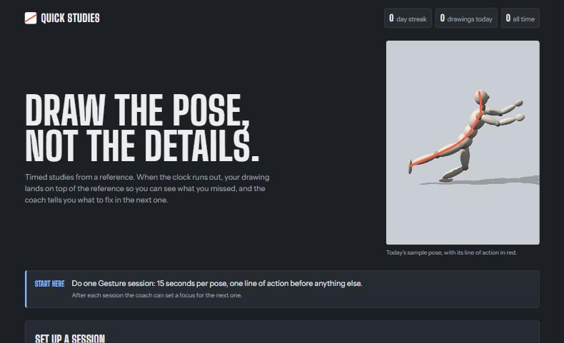
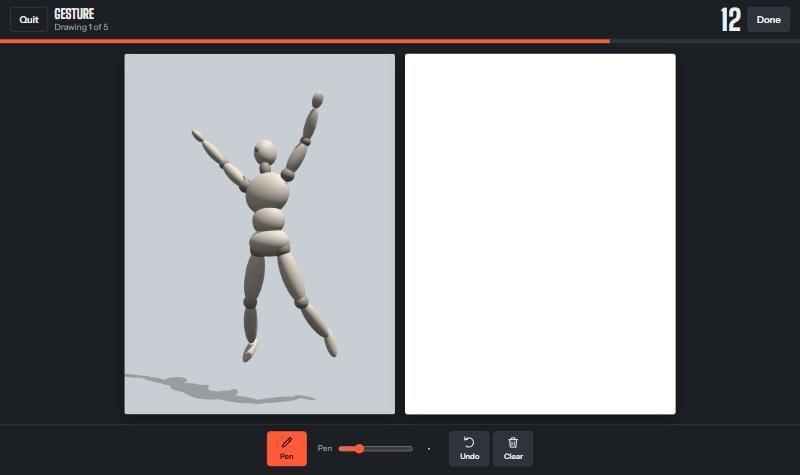

# Quick Studies

Structured drawing practice from a reference. Look at the reference first, draw it against the clock, see what drifted, fix it, then test yourself on a new reference to check that the fix carries over.

**Try it:** [stratolark.dev/quick-studies](https://stratolark.dev/quick-studies/index.html) · [Project page](https://stratolark.dev/projects/quick-studies)



## Why

Drawing improves with short, deliberate practice. Version 2 builds each session around one learning loop:

1. **Observe.** Study the reference and mark its structure, such as the line of action, the horizon or the darkest shape.
2. **Draw.** Draw it on a timer with no hints on screen.
3. **Analyze.** The app measures what it can verify and names the single most important issue.
4. **Correct.** Draw the same reference again with that one correction in mind, then compare before and after.
5. **Transfer.** Draw a new, comparable reference without any help. Only these results count toward your progress.

## Features

- **Three session types.** Quick (about 8 minutes), Focused (30 minutes) and Deep (45 minutes). You can turn stages on and off and change every duration under "Adjust stages".
- **Skills in four tracks.** Gesture and movement, shape and proportion, form and perspective, and values and lighting. Each exercise trains one objective.
- **Measured feedback.** The line of action, silhouette proportions and value placement are measured against geometry taken from the generated 3D scene. Every measurement shows its tolerance and its limits.
- **Guidance levels.** Guided, Assisted and Independent. Suggested changes come only from your independent results, never from drawing counts.
- **Construction guides.** Step-by-step overlays generated from the 3D scene, labelled as procedural guides rather than an artist's demonstration.
- **Progress that keeps evidence apart.** Practice activity, assisted retries and independent tests are tracked separately. Small samples say "not enough evidence" instead of showing a trend.
- **Optional AI coach.** An AI explanation can be requested through a small backend with a provider adapter. It is off until you opt in, and it never overrides the measurements.
- **Free practice.** No timer and no scores. Generate as many mannequin poses or objects in perspective as you like, and draw them next to the reference or trace over a faded copy of it. You can switch views and change the fade while you draw.
- **Timed studies.** The original quick-fire sessions are still there: Gesture (15 s), Shapes (30 s) and Values (60 s).
- **Made for a stylus.** It reads pen pressure and ignores your palm while you draw with a pen.



## Keyboard shortcuts

| Key             | Action                                        |
| --------------- | --------------------------------------------- |
| P, L, X, B      | Pen, lasso, cut, brush (when the mode has it) |
| 1, 2, 3         | Light, mid and dark grey in Values mode       |
| [ and ]         | Smaller or larger brush                       |
| Ctrl+Z or Cmd+Z | Undo                                          |
| Enter or Space  | Skip the countdown before a drawing           |
| Enter           | Finish the current drawing early              |

## Run it locally

You need Node.js 22 or later.

```bash
git clone https://github.com/stratolark/quick-drawing-studies.git
```

```bash
cd quick-drawing-studies
```

```bash
npm install
```

```bash
npm run dev
```

Open the address Vite prints (by default `http://localhost:5173`). The app works fully without the AI coach.

### Optional AI coach

The coach runs as a separate Node server. The Vite dev server forwards `/api` to it.

To try it without an API key, start the mock coach in a second terminal:

```bash
npm run server:mock
```

To use Claude, copy `env.example` to `.env`, set `ANTHROPIC_API_KEY` and `QS_COACH_PROVIDER=anthropic`, then run:

```bash
npm run server
```

The key stays on the server. The server listens on `127.0.0.1` by default and refuses to listen on any other address with a paid provider unless `QS_ACCESS_TOKEN` is set. It also enforces per-client rate limits, a daily spending budget, request size and image checks, and a timeout. In the app, turn on "Allow sending drawings to the AI coach" before asking for feedback.

### Tests, lint and build

```bash
npm test
```

```bash
npm run lint
```

```bash
npm run format
```

```bash
npm run build
```

The tests never call a paid model. `npm run lint` runs ESLint on the JavaScript and Stylelint on the CSS. `npm run format` rewrites files with Prettier, and `npm run format:check` only reports. `npm run build` writes a static site to `dist/` with relative paths, so it can be served from a sub-path. `npm run server` also serves `dist/` when it exists.

## How it works

| Path            | Contents                                                                              |
| --------------- | ------------------------------------------------------------------------------------- |
| `index.html`    | Markup for every screen                                                               |
| `src/app.js`    | Drawing canvas, tools, timer, compare view and the timed-studies flow                 |
| `src/refs/`     | Generated references (three.js) and the projection helpers that record their geometry |
| `src/learning/` | Curriculum, session state machine, progress and recommendations, versioned storage    |
| `src/analysis/` | Gesture, shape and value measurements, issue ranking, before-and-after comparison     |
| `src/learn/`    | The V2 screens: observe, review, summary, progress, construction guides               |
| `src/free/`     | Free practice: untimed drawing from generated references, side by side or tracing     |
| `src/coach/`    | AI coach contract (validation, sanitizing) and browser client                         |
| `server/`       | Optional coach backend: guards, prompt, Claude and mock providers                     |
| `test/`         | Unit and integration tests, plus a labelled feedback-quality dataset                  |

See [docs/ARCHITECTURE.md](docs/ARCHITECTURE.md) for the session state machine, the analysis pipeline, the data model, security and the known limitations.

Progress is saved in your browser's local storage. Images you add as references last until you close the tab.

## License

[MIT](LICENSE). three.js is © three.js authors and also MIT licensed.
