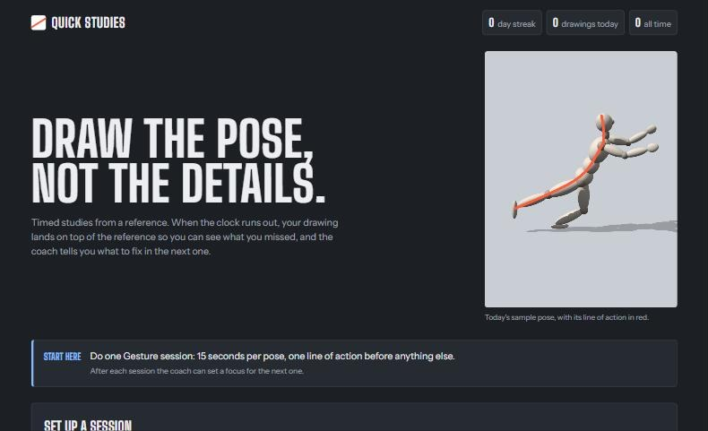
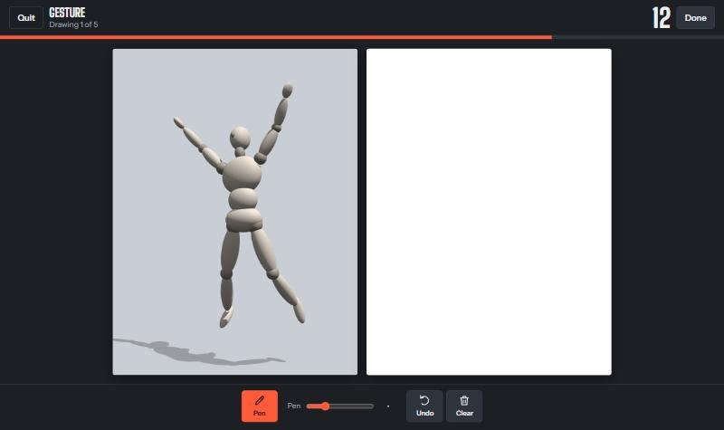

# Quick Studies

Timed drawing practice from a reference. Draw against the clock, then see your drawing laid over the reference so you can check what you missed.

**Try it:** [stratolark.dev/quick-studies](https://stratolark.dev/quick-studies/index.html) · [Project page](https://stratolark.dev/projects/quick-studies)



## Why

Drawing improves fastest with short, deliberate practice every day. A short timer forces you to draw only what matters: the line of action, the big shapes and the negative space. Laying your drawing over the reference shows exactly where it drifted, so you know what to fix in the next one.

## Features

- **Three modes, each with its own tools.** You can change the time for each one.
  - **Gesture, 15 seconds.** Pen only. Trains the line of action and movement.
  - **Shapes, 30 seconds.** Lasso fill, lasso cut and pen. Trains big shapes and negative space.
  - **Values, 60 seconds.** Three greys with a lasso and a brush, no lines. Trains light and dark in big shapes.
- **Generated references.** Movement gives a posed artist's mannequin from a new angle each time. Perspective gives boxes, a city street, a still life or a row of columns. Everything is rendered in the browser with three.js.
- **Your own references.** Add character, creature, pose or environment images and tag them, so a session picks the right kind.
- **Compare.** When the time runs out, your drawing is laid over the reference in red. Drag it and resize it to line it up.
- **Self-check.** Each mode gives a short list of what to look for before the next drawing.
- **Progress.** Your day streak, drawings per day and recent sessions are saved in your browser.
- **Made for a stylus.** It reads pen pressure and ignores your palm while you draw with a pen.



## Keyboard shortcuts

| Key             | Action                                        |
| --------------- | --------------------------------------------- |
| P, L, X, B      | Pen, lasso, cut, brush (when the mode has it) |
| 1, 2, 3         | Light, mid and dark grey in Values mode       |
| [ and ]         | Smaller or larger brush                       |
| Ctrl+Z or Cmd+Z | Undo                                          |
| Enter or Space  | Skip the countdown before a drawing           |
| Enter           | Finish the current drawing early              |

## Run it locally

There is no build step and nothing to install. Clone the repository and open `index.html` in a browser:

```bash
git clone https://github.com/stratolark/quick-studies.git
```

You can also serve the folder with any static file server, for example:

```bash
npx serve .
```

Fonts load from Google Fonts. Everything else, including three.js, is in the repository.

## How it works

| File           | Contents                                                                 |
| -------------- | ------------------------------------------------------------------------ |
| `index.html`   | Layout and styles for the start, drawing, compare and summary screens    |
| `app.js`       | Sessions, timer, drawing tools, comparison view, self-check and progress |
| `refs3d.js`    | Generated references: the posed mannequin and the perspective scenes     |
| `three.min.js` | [three.js](https://threejs.org/) r149, bundled so the app needs no CDN   |

Progress is saved in your browser's local storage. Images you add as references last until you close the tab.

## License

[MIT](LICENSE). three.js is © three.js authors and also MIT licensed. Its license header is kept at the top of `three.min.js`.
