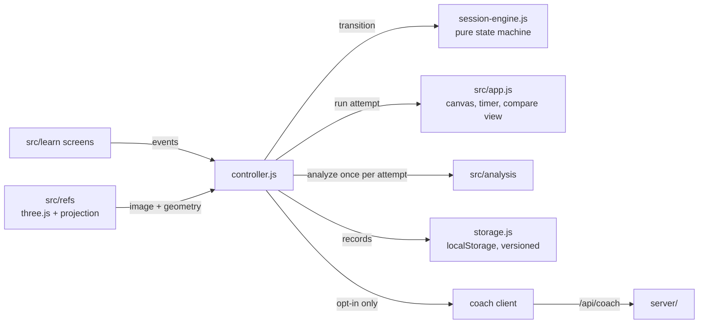
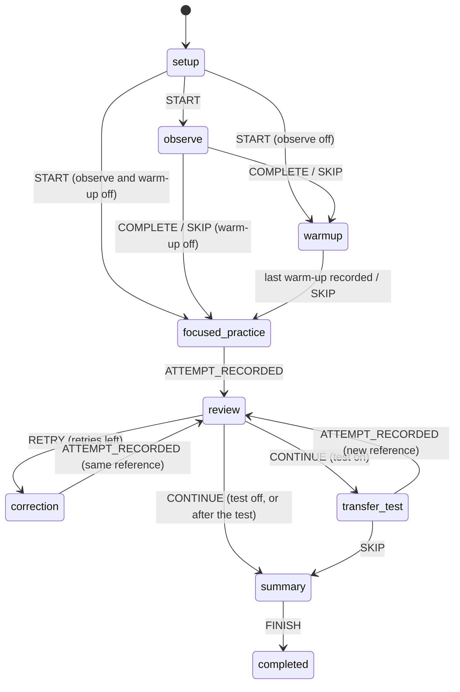
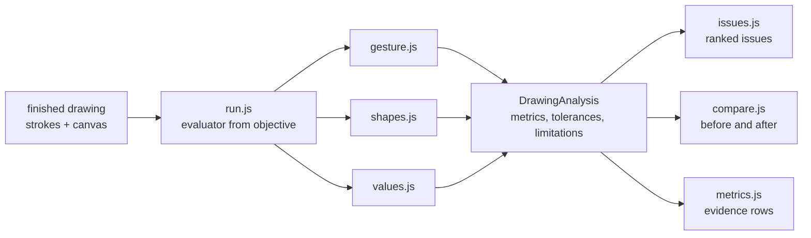

# Quick Studies V2: architecture

This document explains how the learning loop is built, what each measurement can and cannot tell you, how data is stored and how the optional AI coach is secured.

## Overview

- `src/app.js` keeps the drawing canvas, tools, timer, compare view and the timed-studies flow. V2 drives the same drawing and compare screens through a few hooks: `startV2Attempt`, `onRoundEnd`, `onReview`, `onNext`, `annotate` and `onQuit`.
- `src/free/practice.js` drives the same drawing screen through `startFreeAttempt` (no countdown, timer or review) and `setTrace` (the reference shown faded under the canvas). It stores only its preferences under `qs.free` and adds finished drawings to the daily count. Nothing is measured.
- `src/learn/controller.js` is the only module that dispatches session events. Each stage has one entry action in the `ENTER` table.
- Analysis runs once, after a drawing ends. It never runs per pen event, so drawing latency is unchanged.

## Session state machine

`src/learning/session-engine.js` is pure: `transition(state, event)` returns a new state and touches no DOM, storage, timer or AI.

Rules the engine enforces, each covered by a test:

- A focused attempt must use the reference shown in observation.
- A correction must use the same reference. Its `parentId` points at the attempt that was reviewed.
- The transfer reference must differ from the focus reference, and the transfer attempt must use it.
- `END_EARLY` goes to the summary and keeps every finished attempt. With nothing finished it goes straight to `completed`.
- `ERROR` is recorded beside the stage. It never moves the learner or drops attempts. `RECOVER` clears it.
- `PAUSE` blocks drawing events until `RESUME`.
- `assistance(state)` decides what the learner may see. During the transfer test it returns nothing at every guidance level: no objective, no correction, no guides and no live feedback.

## Curriculum

`src/learning/curriculum.js` holds typed tables keyed by ID:

- **Tracks:** gesture, shape, form and values.
- **Objectives:** each objective names its track, tool mode, evaluator, `focusMetric`, observation questions, observation interaction, self-check, default seconds and prerequisites. Prerequisites are guidance only. The learner can choose any objective.
- **Session templates:** Quick, Focused and Deep, with stage minutes from the brief. `buildPlan(type, objective, overrides)` turns a template into concrete seconds and counts. Stored overrides are validated, so a corrupted value falls back to the default.
- **Guidance levels:** Independent, Assisted and Guided. Each sets how many questions appear, when overlays may appear after observation (never, on request, or automatically) and whether the objective shows while drawing.

## Reference metadata

`src/refs/refs3d.js` renders each reference and records its geometry with the same camera, after rendering. `src/refs/projection.js` holds the projection math, which is unit-tested against cameras with known answers.

| Field                              | Source                                                                            | Used by                                                 |
| ---------------------------------- | --------------------------------------------------------------------------------- | ------------------------------------------------------- |
| `actionLine`                       | Projected head, neck, chest and pelvis joints, then the farther-reaching leg      | Gesture analysis, observation check, construction guide |
| `landmarks`, `massRadii`           | Projected joints, plus sphere radii projected through the camera's right axis     | Construction guide                                      |
| `silhouette.bbox` + in-memory mask | Second render with a flat black override material, at a quarter of the image size | Shape analysis, observation check                       |
| `horizon`                          | Vanishing row of horizontal directions                                            | Observation check, construction guide                   |
| `vanishingPoints`, `forms`         | Box axes and projected box corners                                                | Construction guide                                      |
| `light`                            | Key light direction in camera space                                               | Values guide and wording                                |
| `difficulty`                       | Pose tier (1 to 3), camera angles                                                 | Comparable transfer references                          |

The reference ID includes the generator version, seed and options, so a stored generated reference can be re-rendered. User images get `source: 'upload'` and no geometry, so every measurement reports itself unavailable for them.

## Analysis pipeline

- **Gesture** (`gesture-1`). Takes pen strokes after the last clear. Candidates are single strokes plus consecutive pairs whose ends meet. The main line is scored on length, span, smoothness and stroke order, without looking at the reference, so the choice cannot hide a mistake. Scribbles are rejected. When two different-angle candidates score within 12% of each other, the status is `ambiguous` and the learner picks the line they meant. The comparison removes position and uniform scale, keeps rotation and mirroring, and treats a reversed stroke as the same line. It reports tilt difference, bend (signed deviation from the chord), C or S curve type, and a normalized shape difference.
- **Shapes** (`shapes-1`). Fits the painted mask to the reference silhouette by translation and one uniform scale from bounding-box area. Reports the height-to-width ratio error and the silhouette overlap.
- **Values** (`values-1`). Splits the reference into three tones with a two-threshold Otsu search on its own luminance. Reads the study as paper, mid or dark. Compares dark coverage, dark-mass offset and per-cell agreement in canvas position.
- **Issues.** Each rule reads metrics only and returns one issue with its measured sentence, why it matters, one fix and a short retry objective. The objective's `focusMetric` multiplies matching issues by 1.5. Only measured attempts produce issues.
- **Comparison.** A change counts only when it exceeds the metric's change threshold. Smaller changes are reported as "about the same". Attempts measured with different analysis versions are not compared.

Tolerances and change thresholds were set by judgment against synthetic cases. They have not been validated against human ratings.

## Progress and recommendations

`src/learning/progress.js` derives everything from stored attempts on demand, so progress cannot drift out of sync with them.

- **Independent performance:** transfer attempts only, measured, with the current analysis version. The median needs at least 3 tests. A trend needs at least 6 (the median of the first three against the last three) and a change larger than the metric's change threshold.
- **Assisted retries:** tracked separately. The improvement rate needs at least 3 measured retries.
- **Recurring difficulties:** the main issue counted over the last 10 measured attempts, listed when it appears at least twice.
- **Recommendation order:** a recurring measured difficulty, then the learner's own reflection (labelled as self-assessment), then a track not practiced for 5 days, then progression once 3 independent tests are within tolerance, otherwise keep going. A new learner is told that no practice is recorded yet. No history is invented.
- **Adaptation:** guidance and pose difficulty change only after 3 consecutive independent results. Only one dimension changes at a time: guidance comes down before poses get harder. Each suggestion carries its reason, and the learner applies it.
- **Distributed practice:** when another practiced track is due for review, the warm-ups use it.

## Data model

All records live in `localStorage`. The timed-studies flow keeps its own keys (`qs.settings`, `qs.profile`, `qs.sessions`) in `src/app.js`, and the Recent list reads its sessions from that flow's state. Older data shapes are not migrated.

| Key              | Record                                                       | Cap |
| ---------------- | ------------------------------------------------------------ | --- |
| `qs.v2.sessions` | LearningSession                                              | 80  |
| `qs.v2.attempts` | DrawingAttempt                                               | 400 |
| `qs.v2.prefs`    | guidance and pose tier per track, AI opt-in, stage overrides |     |
| `qs.v2.feedback` | Disagreement notes on measured or AI feedback                | 200 |

When the store is full, the oldest half of a collection is dropped and the write is retried once.

- **LearningObjective** (in code, `OBJECTIVES`): `id`, `track`, `description`, `criteria`, `exercises`, `evaluator`, `focusMetric`, `prerequisites`.
- **DrawingReference** (`toReferenceRecord`): `id`, `source`, `metaVersion`, `generator`, `seed`, `options`, `width`, `height`, `difficulty`, `camera`, `geometry` (coordinate system `image-px-top-left`, action line, landmarks, silhouette box, horizon, vanishing points, light).
- **DrawingAttempt** (`toAttemptRecord`): `id`, `sessionId`, `referenceId`, `objectiveId`, `mode`, `durationSec`, `guidance`, `type` (warmup, initial, correction or transfer), `parentId`, `analysis` (version, evaluator, status, metrics, tolerances, limitations, compact line), `issues`, `comparison`, `feedback` (AI main issue and flags only), `createdAt`. Raw strokes are not stored.
- **DrawingAnalysis**: `version`, `evaluator`, `status` (measured, ambiguous, unavailable or empty), `metrics`, `tolerances`, `limitations`, `annotations`, `compact`.
- **LearningSession** (`toSessionRecord`): engine state (`type`, `stage`, `plan`, `guidance`, `attempts` with types and parents) plus `references`, `corrections`, `transfer`, `summary`, `observation`, `reflection`, `startedAt`, `endedAt`.
- **SkillProgress**: computed by `trackProgress()`. It is not stored.

## AI coach

- **Contract.** `src/coach/schema.js` is shared by browser and server. It validates the request (known objective and attempt type, evidence keys this exercise actually measures, one to three images whose real format and size come from their headers). It defines the structured-output schema, where evidence sources are limited to the keys sent plus `visual`. It sanitizes the response: it rejects wrong shapes, drops evidence that cites unknown metrics, and replaces any number with a unit that does not match a sent measurement with "(unmeasured)".
- **Prompt.** `server/prompt.js` builds the prompt on the server from validated fields. The client never sends prompt text, so the endpoint cannot be used as a general model proxy. Measurements are marked as verified, and image text is treated as artwork.
- **Provider.** `server/providers/anthropic.js` makes one `messages.create` call with JSON-schema output, adaptive thinking at the configured effort, and the server-side refusal fallback (`fallbacks: "default"`), which `QS_FALLBACKS=off` disables. It maps SDK errors to typed codes and records cost for the budget. `server/providers/mock.js` is deterministic and can simulate slowness, timeouts, malformed answers, invented numbers, refusals and errors.
- **Guards** (`server/guards.js`, `server/app.js`): access code with constant-time comparison, per-client limits per minute and per day, daily spending budget, body size limit, timeout, and abort when the client disconnects. Logs hold request ID, status, latency and token counts, never bodies or images.
- **Client.** `src/coach/client.js` sends only after opt-in, times out after 70 s, can be cancelled, and re-sanitizes every answer. The review panel shows AI output in its own section, labelled as suggestions. Progress uses local measurements only.

## Known limitations

- **Gesture.** Only the main line is measured. The generator's line of action runs from the head to the farther-reaching foot, which can differ from what an artist would call the line of action in seated, crouching or reclined poses. Candidate selection is heuristic. When it is unsure it asks, but it can still pick the wrong stroke without flagging it.
- **Shapes.** This analysis needs the silhouette mask, so it works only for generated mannequins. A different valid simplification can lower the overlap.
- **Values.** Comparison happens in canvas position, so a smaller or shifted study scores worse. The automatic three-tone split can disagree with a valid human grouping.
- **Form and perspective.** These exercises have no automatic drawing evaluator. Only the observation check (horizon) and self-checks apply.
- **User images.** These have no verified geometry, so their measurements are unavailable and only self-checks apply.
- **AI.** Feedback quality has not been evaluated against human judgments. The labelled dataset in `test/fixtures/feedback-cases.js` checks the measurement layer only, and its `humanLabel` fields are empty. AI ratings are uncalibrated, so none are shown.
- **Tolerances and thresholds** come from judgment, not from validation data.
- **Storage** is per browser. The optional remote `Store` in `src/app.js` covers only the timed-studies flow.
- **Hot reload.** Editing source while `npm run dev` runs reloads the page and drops the session in progress. The finished drawings are kept, and the session is listed as interrupted.
